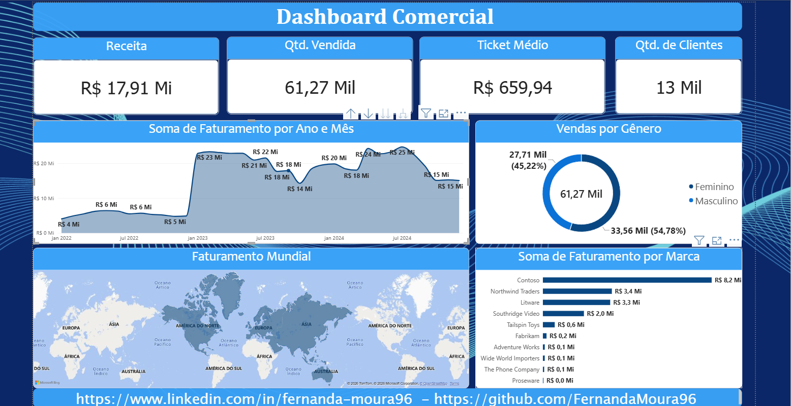
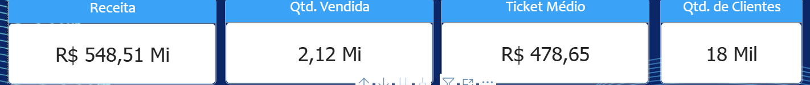
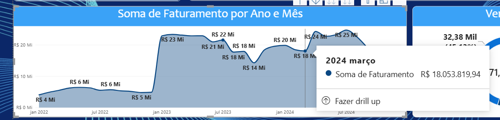
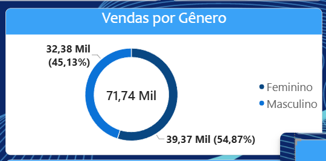
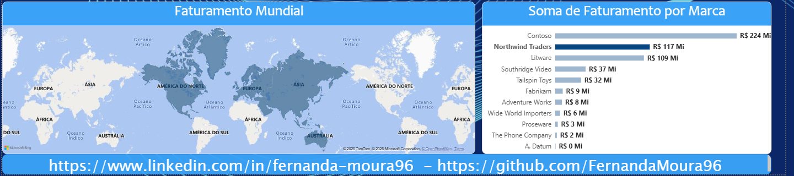
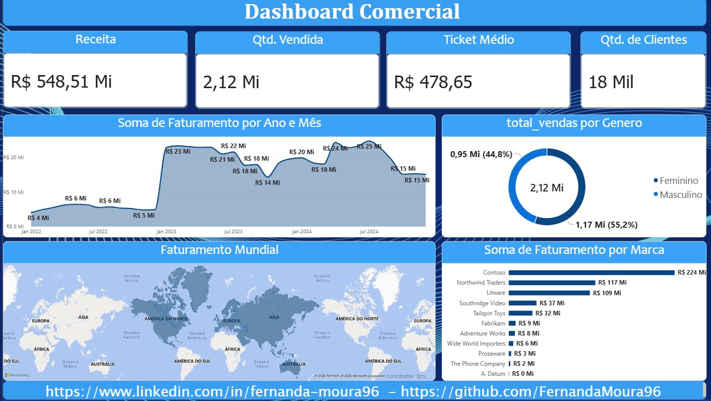
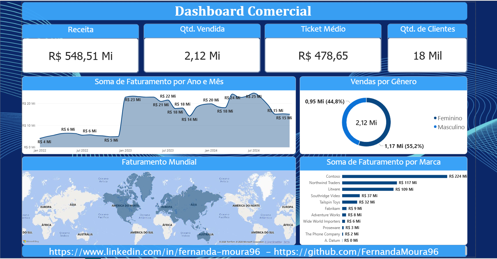
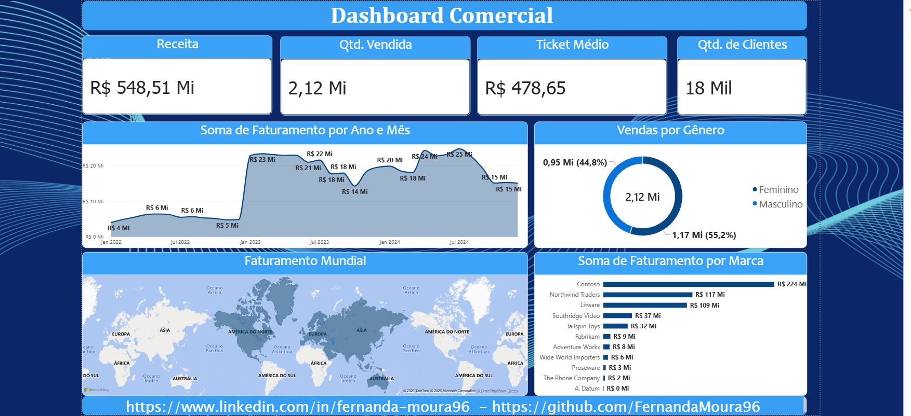

# 📊 Dashboard Comercial — Power BI

Dashboard interativo em Power BI para acompanhar o desempenho comercial de uma operação de vendas: quanto foi faturado, quantas unidades foram vendidas, qual o ticket médio, quantos clientes compraram e qual marca lidera o faturamento em cada região.

---

## 📌 Sumário
- [Objetivo](#-objetivo)
- [Perguntas de negócio](#-perguntas-de-negócio-respondidas)
- [Indicadores](#-indicadores-visão-geral-sem-filtros)
- [Visuais do dashboard](#-visuais-do-dashboard)
- [Interatividade](#-interatividade)
- [Principais insights](#-principais-insights)
- [Screenshots](#-screenshots)
- [Medidas DAX](#-medidas-dax)
- [Ferramentas utilizadas](#-ferramentas-utilizadas)
- [Estrutura do repositório](#-estrutura-do-repositório)
- [Como usar](#-como-usar)
- [Aprendizados](#-aprendizados)
- [Autora](#-autora)

---

## 🎯 Objetivo
Construir um painel que permita acompanhar o desempenho comercial de forma rápida e explorar os números por diferentes ângulos (marca, localização, período e gênero), traduzindo perguntas de negócio em indicadores claros.

---

## ❓ Perguntas de negócio respondidas

| # | Pergunta | Onde responder no dashboard |
|---|---|---|
| 1 | Qual o faturamento total? | Cartão **Receita** |
| 2 | Quantas unidades foram vendidas? | Cartão **Qtd. Vendida** |
| 3 | Qual o ticket médio? | Cartão **Ticket Médio** |
| 4 | Quantos clientes compraram? | Cartão **Qtd. de Clientes** |
| 5 | Como o faturamento evoluiu ao longo do tempo? | Gráfico **Soma de Faturamento por Ano e Mês** |
| 6 | Qual marca mais fatura? | Gráfico **Soma de Faturamento por Marca** |
| 7 | Qual marca teve o maior faturamento em determinada região? | Mapa **Faturamento Mundial** |
| 8 | Como as vendas se distribuem entre os gêneros? | Gráfico de rosca **Vendas por Gênero** |

---

## 📈 Indicadores (visão geral, sem filtros)

| Indicador | Valor |
|---|---|
| Receita | R$ 548,51 Mi |
| Quantidade vendida | 2,12 Mi |
| Ticket médio | R$ 478,65 |
| Quantidade de clientes | 18 Mil |

---

## 🧩 Visuais do dashboard

| Visual | O que mostra |
|---|---|
| **Cartões de KPI** | Receita, quantidade vendida, ticket médio e quantidade de clientes |
| **Gráfico de área** | Faturamento mensal de jan/2022 a dez/2024, com *drill-down* entre ano e mês |
| **Gráfico de rosca** | Distribuição das vendas (em unidades) entre Feminino e Masculino |
| **Mapa** | Faturamento por localização, mostrando qual marca teve o maior faturamento em cada área |
| **Gráfico de barras** | Faturamento total por marca, em ordem decrescente |

---

## 🖱️ Interatividade

O dashboard é totalmente interativo. Ao clicar em qualquer elemento, todos os demais visuais são recalculados, o que permite:
- **Filtrar por marca:** clique em uma barra e veja KPIs, evolução mensal, gênero e mapa apenas daquela marca.
- **Filtrar por localização:** selecione uma área no mapa para isolar o faturamento da região.
- **Filtrar por período:** clique em um ponto do gráfico de área para analisar um mês específico ou use o *drill up/down* entre ano e mês.
- **Filtrar por gênero:** clique em uma fatia da rosca para ver apenas aquele público.
- **Ver detalhes ao passar o mouse:** os *tooltips* mostram o valor exato (ex.: março/2024 = R$ 18.053.819,94).

💡 *Para explorar essas interações, abra o arquivo `dashboard_comercial.pbix` no Power BI Desktop. Para limpar um filtro, clique novamente no elemento selecionado ou em uma área vazia do visual.*

---

## 🔍 Principais insights

- **Alta concentração por marca:** a Contoso responde por cerca de 41% da receita (R$ 224 Mi). Somadas, as três maiores marcas (Contoso, Northwind Traders e Litware) representam cerca de 82% do faturamento.
- **Mudança de patamar em 2023:** o faturamento mensal fica entre R$ 4 Mi e R$ 6 Mi em 2022 e passa para a faixa de R$ 14 Mi a R$ 25 Mi a partir de jan/2023.
- **Pico em 2024:** o maior faturamento mensal é de cerca de R$ 25 Mi, em meados de 2024, seguido de queda para cerca de R$ 15 Mi no fim do período.
- **Público:** o gênero feminino representa 55,2% das unidades vendidas (1,17 Mi) e o masculino 44,8% (0,95 Mi).

⚠️ *O gráfico de gênero mostra quantidade de unidades, não receita.*

---

## 📸 Screenshots

### Visão Geral do Dashboard


### Cartões de KPI


### Evolução do Faturamento com Tooltip


### Vendas por Gênero


### Faturamento Mundial e por Marca


### Exemplos de Demonstração
<p align="center">
  
  
</p>
<p align="center">
  
</p>

---

## 🧮 Medidas DAX

⚠️ *Os nomes de tabelas e colunas abaixo são ilustrativos. Consulte o arquivo `.pbix` para ver as medidas exatamente como foram criadas.*

```dax
Total Vendido = SUM(Vendas[Qtd_Vendida])

Faturamento = SUM(Vendas[Faturamento])

Ticket Médio = DIVIDE([Faturamento], DISTINCTCOUNT(Vendas[ID_Pedido]))

Qtd. de Clientes = DISTINCTCOUNT(Vendas[ID_Cliente])

## 🛠️ Ferramentas utilizadas
Power BI Desktop — modelagem, medidas DAX e visualizações

DAX — criação das métricas e KPIs

Excel (.xlsx) — fonte dos dados utilizados no dashboard

📂 Estrutura do repositório

├── README.md
├── dashboard_comercial.pbix   # Arquivo principal do Power BI
├── data/                      # Arquivos .xlsx com as bases de dados utilizadas
└── screenshots/               # Prints do dashboard para o README

dashboard_comercial.pbix — arquivo do Power BI com o modelo de dados, as medidas DAX e todos os visuais.

data/ — bases .xlsx usadas como fonte do dashboard.

screenshots/ — prints do dashboard final, detalhamentos e interações.

🚀 Como usar
Clone o repositório:

Bash
git clone https://github.com/FernandaMoura96/Dashboard-Comercial.git
Instale o Power BI Desktop (gratuito, disponível para Windows).

Abra o arquivo dashboard_comercial.pbix.

Se o Power BI pedir, atualize o caminho das fontes de dados: Transformar dados → Configurações da fonte de dados → Alterar origem, apontando para a pasta data/ do seu computador.

Explore o dashboard clicando nas marcas, no mapa, nos meses e nas fatias do gráfico de gênero.

Se preferir recriar o projeto do zero, importe os arquivos da pasta data/ no Power BI Desktop, crie as medidas DAX descritas acima e monte os visuais conforme os prints da pasta screenshots/.

📚 Aprendizados
Criação de medidas em DAX (soma, razão, contagem distinta)

Construção de cartões de KPI e organização visual de um dashboard

Uso de interações entre visuais (filtro cruzado, drill-down e tooltips)

Tradução de perguntas de negócio em indicadores

👩‍💻 Autora
Fernanda Moura